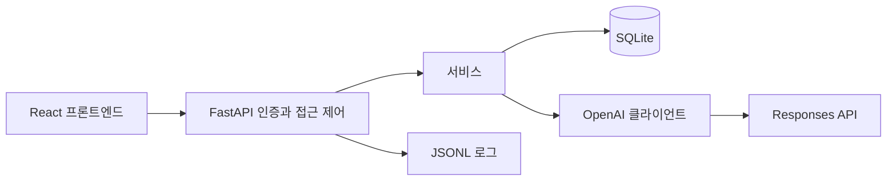

# 꽥꽥이 Backend

로그인한 사용자가 AI와 대화하고 자신의 기록을 다시 확인할 수 있는 웹 챗봇의 FastAPI 백엔드입니다.

[서비스 바로가기](https://www.quackquack-e.duckdns.org)

## 기술 스택

| 영역 | 기술 |
| --- | --- |
| 언어와 API | Python 3.12+, FastAPI, Pydantic |
| DB | SQLite, SQLAlchemy 비동기 세션, aiosqlite |
| 인증 | JWT HS256, Argon2 비밀번호 해싱 |
| AI | OpenAI Responses API |
| 배포와 로그 | Railway, JSONL 이벤트 로그 |
| 개발과 검사 | uv, pytest, Ruff |

## 시스템 구조

계층별 역할과 질문 처리 흐름은 [아키텍처](docs/ARCHITECTURE.md)를 참고합니다.

## 주요 기능

| 기능 | 처리 방식 |
| --- | --- |
| 회원 인증 | 회원가입·로그인·내 정보 조회. JWT 검증과 현재 토큰 폐기 방식의 로그아웃 |
| 사용자별 채팅 | 본인 채팅방 생성·조회·논리 삭제. 빈 채팅방 재사용과 타인 기록 접근 제한 |
| AI 대화 | OpenAI는 방별 Conversation으로 문맥 유지·자동 압축. Conversation 미사용 AI 클라이언트는 최근 완료 대화 최대 5건 사용. 질문은 1~1,000자 |
| 실패 처리 | 전체 제한 시간 기본 30초, 사용자당 1개·전체 3개 동시 질문 제한, 실패 상태 저장과 공통 오류 응답 |
| 관리자 | 회원·세션·대화·시스템 로그 조회와 회원 역할 변경. DB의 관리자 권한 검사 |

질문·답변·생성 시각은 DB에 누적 저장하며 성공 응답은 저장 후 반환합니다. AI 호출과 결과는 요청 ID로 로그에서 추적합니다.

## 기술 문서

| 문서 | 내용 |
| --- | --- |
| [아키텍처](docs/ARCHITECTURE.md) | 계층, 인증·접근 제어, 처리 흐름, 대화 문맥 |
| [데이터베이스](docs/DATABASE.md) | ERD, 저장 방식, 평가자 DB 확인 절차 |
| [API 명세 (Swagger)](https://be-b7-1-development.up.railway.app/docs) | 코드에서 생성한 요청·응답·입력 규칙 확인과 실행 |
| [운영과 배포](docs/OPERATIONS.md) | 환경 변수, Railway, 로그, AI 오류 대응 |
| [개발 환경](docs/GETTING_STARTED.md) | 설치, 로컬 실행, VS Code 설정, 패키지 관리 |
| [시스템 프롬프트](docs/SYSTEM_PROMPT.md) | 한글 검토용 번역과 설명, 영어 도입용 원문 |
| [팀 작업](docs/TEAM.md) | 팀원 역할, 업무 분담과 협업 방식 |
| [프론트 저장소](https://github.com/myy-dev/fe-B7-1#readme) | 화면 사용 안내, 프론트 실행과 배포 |
