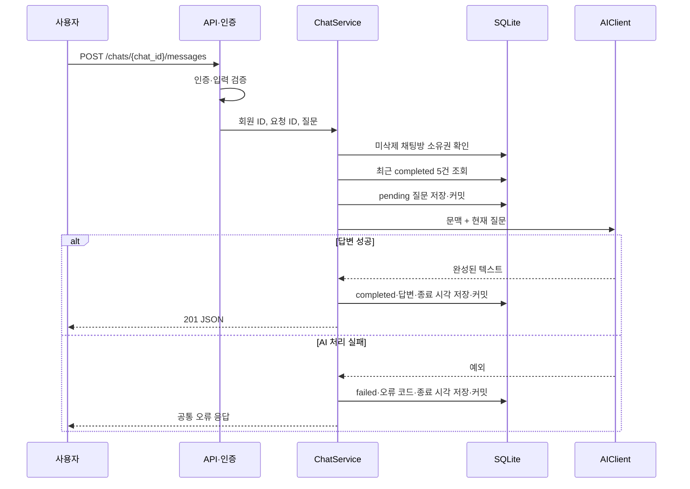

# 아키텍처

React 프론트는 FastAPI를 통해 인증·채팅 기능을 사용합니다. FastAPI는 SQLite에 회원·대화를 저장하고 OpenAI API로 답변을 생성합니다.

## 계층과 수명주기

| 위치 | 책임 |
| --- | --- |
| `app/main.py` | 앱 설정, CORS, 시작·종료 처리 |
| `app/api/` | 라우팅, 입력·응답 검증, 인증 |
| `app/services/` | 회원·채팅·관리자 처리, 소유권 확인 |
| `app/repositories/` | DB 조회·저장, 시스템 로그 조회 |
| `app/models/`, `app/schemas/` | 저장 모델, 요청·응답 형식 |
| `app/clients/ai.py` | AI 클라이언트 공통 계약 (`Protocol`) |
| `app/clients/openai.py` | OpenAI 호출, 재시도·타임아웃, 오류 변환 |
| `app/core/` | 환경 설정, DB, JWT, 요청 ID, 로그, 공통 오류 |

시작 시 `create_all`로 없는 테이블을 만들고 AI 클라이언트를 생성해 공유합니다. DB 세션은 요청마다 사용하며, 종료 시 AI 연결과 DB 엔진을 정리합니다. AI 초기화·종료 실패 시에도 DB 엔진을 정리합니다. `create_all`은 기존 스키마를 변경하지 않으며 별도 마이그레이션은 없습니다.

## 인증과 데이터 소유권

회원가입은 비밀번호를 Argon2로 해시해 일반 회원으로 저장하고, 로그인은 액세스 JWT를 발급합니다. 토큰 기본 유효 시간은 30분이며 refresh token 없이 만료 후 다시 로그인합니다.

프론트는 로그인 토큰과 만료 시각을 탭의 `sessionStorage`에 보관하고 `Authorization: Bearer <access_token>`으로 요청합니다. 만료·인증 요청의 401 응답에서 인증 상태를 지우고, `/api/v1/auth/me`로 현재 회원의 DB 역할을 확인합니다.

서버는 요청마다 JWT 서명·만료·폐기 여부와 회원 존재를 검사합니다. 로그아웃은 현재 토큰의 SHA-256 해시·만료 시각을 DB에 저장해 재사용을 막으며 다른 로그인 토큰은 유지합니다. 관리자 API는 DB의 `role=admin`을 추가 확인하며 일반 회원은 `403 FORBIDDEN`입니다. 관리자 생성은 [운영 안내](OPERATIONS.md#초기-관리자-생성)를 참고합니다.

채팅은 인증한 회원 ID와 `chats.user_id`가 일치하는 미삭제 방만 사용합니다. 본문의 사용자 ID로 소유자를 정하지 않으며, 타인 소유·삭제·없는 방은 모두 `404 CHAT_NOT_FOUND`입니다.

## 질문 처리 흐름

질문과 결과는 같은 기록에 저장하며, AI 호출 중에는 DB 트랜잭션을 열어두지 않습니다. 프로세스 중단이나 결과·실패 상태 저장 오류로 `pending` 기록이 남을 수 있습니다.

## 최근 대화 5개 문맥 전략

같은 방의 `completed` 기록을 `created_at DESC, request_id DESC`로 최대 5건 조회한 뒤 순서를 뒤집습니다. 오래된 질문·답변부터 `user`·`assistant` 메시지로 넣고 마지막에 현재 질문을 추가합니다.

- 5건은 질문·답변 5쌍으로, 이전 메시지 최대 10개와 현재 질문 1개를 전달합니다. `pending`·`failed`·다른 방 기록은 제외하며 DB에는 전체 기록을 보존합니다.
- 호출마다 문맥을 구성하고 `store=False`로 요청합니다. 스트리밍은 사용하지 않으며, 일시적 오류는 같은 질문·문맥으로 [재시도](OPERATIONS.md#ai-재시도와-타임아웃)합니다.
- 현재 질문은 앞뒤 공백 제거 후 1~1,000자로 제한합니다. 토큰 예산에 따른 문맥 축약과 동시 요청 잠금은 지원하지 않으며, `CHAT_BUSY`는 반환하지 않습니다.

저장 구조는 [데이터베이스](DATABASE.md), 실패 대응은 [운영](OPERATIONS.md)을 참고합니다.
