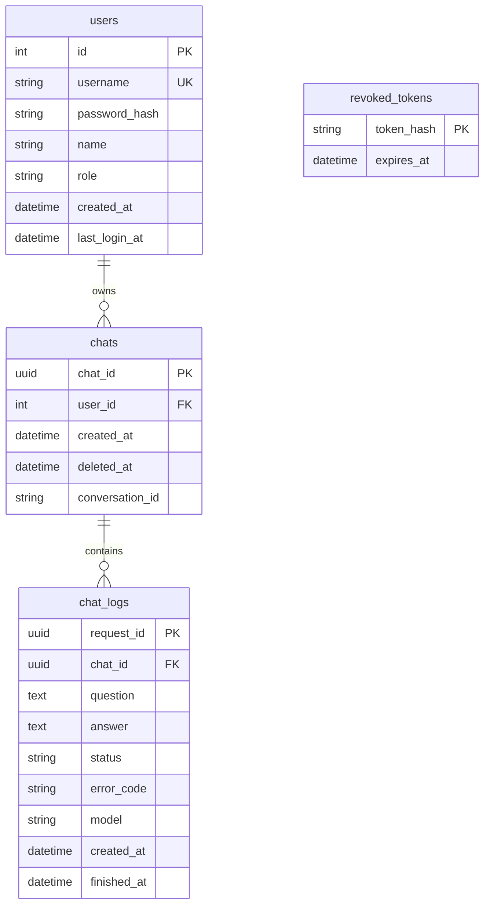

# 데이터베이스

SQLite(`sqlite+aiosqlite`)를 사용하며 `DATABASE_URL`로 파일 위치를 지정합니다. 초기화의 `PRAGMA foreign_keys=ON`은 SQLite 전용이므로 다른 DB로 전환하려면 드라이버와 초기화 코드를 변경해야 합니다.

## ERD



## 테이블·필드

| 테이블 | 역할과 보충 설명 |
| --- | --- |
| `users` | 회원. 고유 `username` 최대 20자, `password_hash` 255자, `name` 50자. `role` 기본 `user`, 관리자 `admin`. `created_at` 가입 시각, `last_login_at` 마지막 로그인 시각(nullable) |
| `chats` | 회원 소유 채팅방. `created_at` 생성 시각, `deleted_at` 논리 삭제 시각(nullable), `conversation_id` OpenAI 대화 식별자(nullable) |
| `chat_logs` | 질문·답변과 처리 결과. `request_id` 최초 질문 요청 ID, `model` 호출 모델, `created_at` 질문 저장 시각, `finished_at` 종료 시각. 상태별 null 조건은 아래 표 참고 |
| `revoked_tokens` | 폐기한 토큰의 SHA-256 해시(64자)와 만료 시각(`expires_at`). 회원 외래키 없음 |

채팅 시각과 API 반환 시각은 UTC입니다. 조회 인덱스는 `chats(user_id, created_at, chat_id)`와 `chat_logs(chat_id, created_at, request_id)`입니다.

## 대화 로그 저장

질문당 한 행을 저장·갱신하며 DB 체크 제약으로 상태 조합을 검사합니다.

| 상태 | answer | error_code | finished_at |
| --- | --- | --- | --- |
| `pending` | null | null | null |
| `completed` | 답변 | null | 종료 시각 |
| `failed` | null | 오류 코드 | 종료 시각 |

질문과 결과는 각각 커밋합니다. SQLAlchemy 저장 예외는 롤백하고 `DB_ERROR`를 반환합니다. 중단된 `pending` 기록의 자동 복구는 없습니다.

## 조회와 삭제

- 사용자: 본인 미삭제 채팅방의 모든 상태 기록을 생성 시각·요청 ID 오름차순으로 조회합니다.
- AI 문맥: OpenAI는 채팅방의 `conversation_id`로 Conversation을 이어가며, Conversation 미사용 AI 클라이언트는 최근 성공 5건을 오래된 순으로 사용합니다. [문맥 전략](ARCHITECTURE.md#대화-문맥-전략) 참고.
- 관리자: 회원·기간별 대화와 회원별 세션을 조회합니다.
- 삭제는 `deleted_at`만 설정합니다. 사용자 조회에서 제외되지만 관리자·DB에는 원본 기록이 남습니다.

## 저장된 질문과 답변 확인

### 사용자 API로 확인

1. [로컬 Swagger](http://127.0.0.1:8000/docs)에서 가입·로그인 → Authorize에 토큰 입력 → 채팅방 생성 → 질문 전송을 진행합니다.
2. 받은 값으로 셸의 `TOKEN`·`CHAT_ID`를 지정하고 내 정보와 채팅 상세를 조회합니다.

```bash
curl http://127.0.0.1:8000/api/v1/auth/me -H "Authorization: Bearer $TOKEN"
curl "http://127.0.0.1:8000/api/v1/chats/$CHAT_ID" -H "Authorization: Bearer $TOKEN"
```

3. 내 정보의 `id`(사용자 식별자)와 상세 `messages[]`의 `question`, `answer`, `created_at`, `status`, `finished_at`을 확인합니다. 성공 상태는 `completed`입니다.
4. 두 번째 질문 후 재조회해 이전 기록과 새 기록이 함께 있는지 확인합니다.
5. 다른 회원의 같은 방 조회는 `404 CHAT_NOT_FOUND`여야 합니다. 재시작·재배포 후 원래 회원으로 조회해 기록 보존을 확인합니다.

운영은 [배포 Swagger](https://be-b7-1-development.up.railway.app/docs)에서 위 절차를 수행하고 명령의 Origin도 해당 서비스 주소로 바꿉니다. 토큰·채팅 ID는 같은 환경의 값을 사용합니다. 실패 기록은 `answer=null`이며 `error_code`·`finished_at`을 확인합니다.

### 관리자 화면으로 확인

[초기 관리자 생성](OPERATIONS.md#초기-관리자-생성) 후 프론트에 로그인합니다. `/admin/users` → 회원 상세 → 세션을 열면 `/admin/sessions/{chat_id}`에서 질문·답변·상태·시각을 확인합니다. `/admin/logs`에서는 회원·기간으로 조회합니다. 일반 회원은 접근할 수 없습니다.

### 읽기 전용 SQL로 확인

Railway CLI에서 `railway ssh`로 배포 컨테이너에 접속한 뒤 실행합니다. 각 명령은 `/data/app.db`를 읽기 전용으로 열고 최근 50건을 출력하며, DB 파일이 없으면 오류를 반환합니다. `railway run`은 로컬에서 실행되므로 운영 볼륨 확인에 사용하지 않습니다.

#### 회원 (`users`)

```bash
python -c "import sqlite3; con=sqlite3.connect('file:/data/app.db?mode=ro', uri=True); con.row_factory=sqlite3.Row; [print(dict(r)) for r in con.execute('SELECT id, username, name, role, created_at, last_login_at FROM users ORDER BY created_at DESC, id DESC LIMIT 50')]; con.close()"
```

#### 채팅방 (`chats`)

```bash
python -c "import sqlite3; con=sqlite3.connect('file:/data/app.db?mode=ro', uri=True); con.row_factory=sqlite3.Row; [print(dict(r)) for r in con.execute('SELECT chat_id, user_id, created_at, deleted_at, conversation_id FROM chats ORDER BY created_at DESC, chat_id DESC LIMIT 50')]; con.close()"
```

#### 대화 기록 (`chat_logs`)

```bash
python -c "import sqlite3; con=sqlite3.connect('file:/data/app.db?mode=ro', uri=True); con.row_factory=sqlite3.Row; [print(dict(r)) for r in con.execute('SELECT c.user_id, l.chat_id, l.request_id, l.question, l.answer, l.status, l.created_at FROM chat_logs AS l JOIN chats AS c ON c.chat_id = l.chat_id ORDER BY l.created_at DESC, l.request_id DESC LIMIT 50')]; con.close()"
```

#### 폐기 토큰 (`revoked_tokens`)

```bash
python -c "import sqlite3; con=sqlite3.connect('file:/data/app.db?mode=ro', uri=True); con.row_factory=sqlite3.Row; [print(dict(r)) for r in con.execute('SELECT token_hash, expires_at FROM revoked_tokens ORDER BY expires_at DESC, token_hash DESC LIMIT 50')]; con.close()"
```

로컬 DB를 확인하려면 각 명령의 `file:/data/app.db?mode=ro`를 `file:app.db?mode=ro`로 바꿉니다. SQL은 전체 회원과 논리 삭제된 방도 조회합니다. 대화 기록에서 특정 회원만 보려면 `ORDER BY` 앞에 `WHERE c.user_id = 원하는 정수`를 추가합니다. SQLite UUID는 하이픈 없이 저장됩니다. 외부 증빙에는 점검용 계정의 기록만 사용합니다.

`create_all`은 기존 테이블을 변경하지 않습니다. 모델 변경에는 별도 마이그레이션·백업이 필요합니다. [백업·보관 안내](OPERATIONS.md#데이터와-비밀값-관리) 참고.
